# Manual de usuario

**Sistema de Gestión Comercial** · Versión del manual 1.0 · Noviembre de 2026

Este manual explica, pantalla por pantalla, cómo usar el sistema para tomar pedidos, prepararlos, cobrarlos y administrar el negocio. Cada captura tiene **números en rojo**; debajo de cada una hay una tabla que explica qué es y para qué sirve cada número.

> Las capturas usan un negocio de ejemplo llamado «Sabor Casero». En tu sistema verás tu propio nombre, logo, colores y productos. Los nombres «Mesa», «Mesero» o «Cocina» también pueden ser otros si tu negocio los cambió en **Mi local**.

## Contenido

1. [Antes de empezar](#1-antes-de-empezar)
2. [Ingresar al sistema](#2-ingresar-al-sistema)
3. [Primer ingreso: tu contraseña personal y los términos](#3-primer-ingreso-tu-contraseña-personal-y-los-términos)
4. [Panel de administración](#4-panel-de-administración)
5. [Menú de hoy](#5-menú-de-hoy)
6. [Productos y fotos](#6-productos-y-fotos)
7. [Categorías](#7-categorías)
8. [Mi local](#8-mi-local)
9. [Usuarios: las cuentas de tu personal](#9-usuarios-las-cuentas-de-tu-personal)
10. [Apariencia](#10-apariencia)
11. [Reportes](#11-reportes)
12. [Actividad](#12-actividad)
13. [Cambiar mi contraseña](#13-cambiar-mi-contraseña)
14. [Atención (mesero): tomar, cobrar y entregar pedidos](#14-atención-mesero-tomar-cobrar-y-entregar-pedidos)
15. [Catálogo para el cliente](#15-catálogo-para-el-cliente)
16. [Preparación (cocina)](#16-preparación-cocina)
17. [Seguridad y buenas prácticas](#17-seguridad-y-buenas-prácticas)
18. [Preguntas frecuentes](#18-preguntas-frecuentes)

---

## 1. Antes de empezar

### Quién usa cada pantalla

| Rol | Qué puede hacer | Pantalla al ingresar |
| --- | --- | --- |
| **Administrador** (dueño o encargado) | Todo: menú del día, productos, categorías, local, usuarios, apariencia, reportes y actividad. También puede usar las pantallas del personal. | Panel de administración |
| **Atención** (mesero, cajero) | Tomar pedidos, mostrar el catálogo, cobrar y entregar. | Atención |
| **Preparación** (cocina, barra) | Ver los pedidos y marcarlos como en preparación y listos. | Preparación |

### Qué necesitas

- Un celular, tablet o computadora con navegador (Chrome, Edge, Safari o Firefox).
- Estar conectado a la **misma red Wi‑Fi** que la computadora donde está instalado el sistema, o a la dirección de internet que te dio tu encargado.
- Tu **usuario** y tu **contraseña**.

> **Consejo:** en el celular, abre la dirección del sistema y usa la opción «Agregar a pantalla de inicio» del navegador. Así lo abres como una aplicación.

### Quién es responsable de qué

El sistema se entrega instalado y bajo el **control exclusivo de tu negocio**. El proveedor que lo desarrolló **no guarda contraseñas ni tiene acceso** a tu sistema ni a tus datos. Por eso:

- El administrador de tu negocio crea y retira las cuentas del personal.
- Cada persona cuida su propia contraseña.
- El negocio hace los **respaldos** de la información (ver [Instalación y mantenimiento → Respaldos](INSTALACION.md#7-respaldos)).

---

## 2. Ingresar al sistema

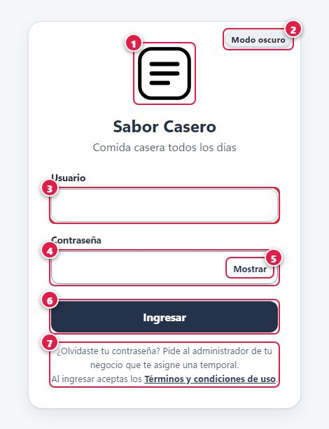

*Pantalla de ingreso*

| N.º | Elemento | Para qué sirve |
| :-: | --- | --- |
| **1** | Logo y nombre del negocio | Se configuran en Administración → Apariencia. |
| **2** | Modo oscuro / claro | Cambia los colores de la pantalla en este dispositivo. |
| **3** | Usuario | El nombre de usuario que te entregó el administrador (en minúsculas). |
| **4** | Contraseña | Tu contraseña personal. Distingue mayúsculas y minúsculas. |
| **5** | Mostrar / Ocultar | Permite ver lo que escribiste para revisar errores. |
| **6** | Ingresar | Entra al sistema. Cada rol llega a su pantalla: administración, atención o preparación. |
| **7** | Ayuda y términos | Qué hacer si olvidaste tu contraseña y enlace a los Términos y condiciones de uso. |

Si el usuario o la contraseña no coinciden, verás este mensaje:

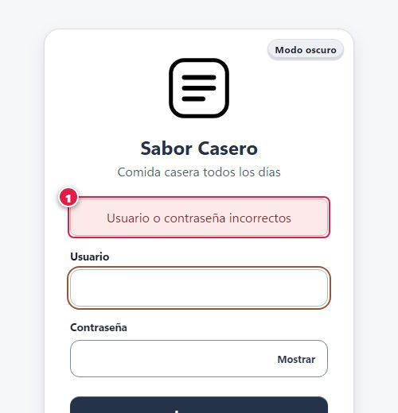

*Mensaje de error al ingresar*

| N.º | Elemento | Para qué sirve |
| :-: | --- | --- |
| **1** | Mensaje de error | Aparece si el usuario o la contraseña no coinciden. Por seguridad no se indica cuál de los dos está mal. |

- Después de **5 intentos fallidos** seguidos, esa cuenta queda bloqueada **15 minutos** desde ese dispositivo. Es una protección contra quien intente adivinar contraseñas. Espera el tiempo indicado y vuelve a intentar.
- Si olvidaste tu contraseña, pide al administrador que te asigne una **temporal** (sección 9).

---

## 3. Primer ingreso: tu contraseña personal y los términos

La primera vez que entras con una cuenta nueva —o después de que el administrador te asigne una contraseña temporal— el sistema te pide dos cosas antes de dejarte trabajar. **No puedes usar ninguna otra pantalla hasta completarlo.**

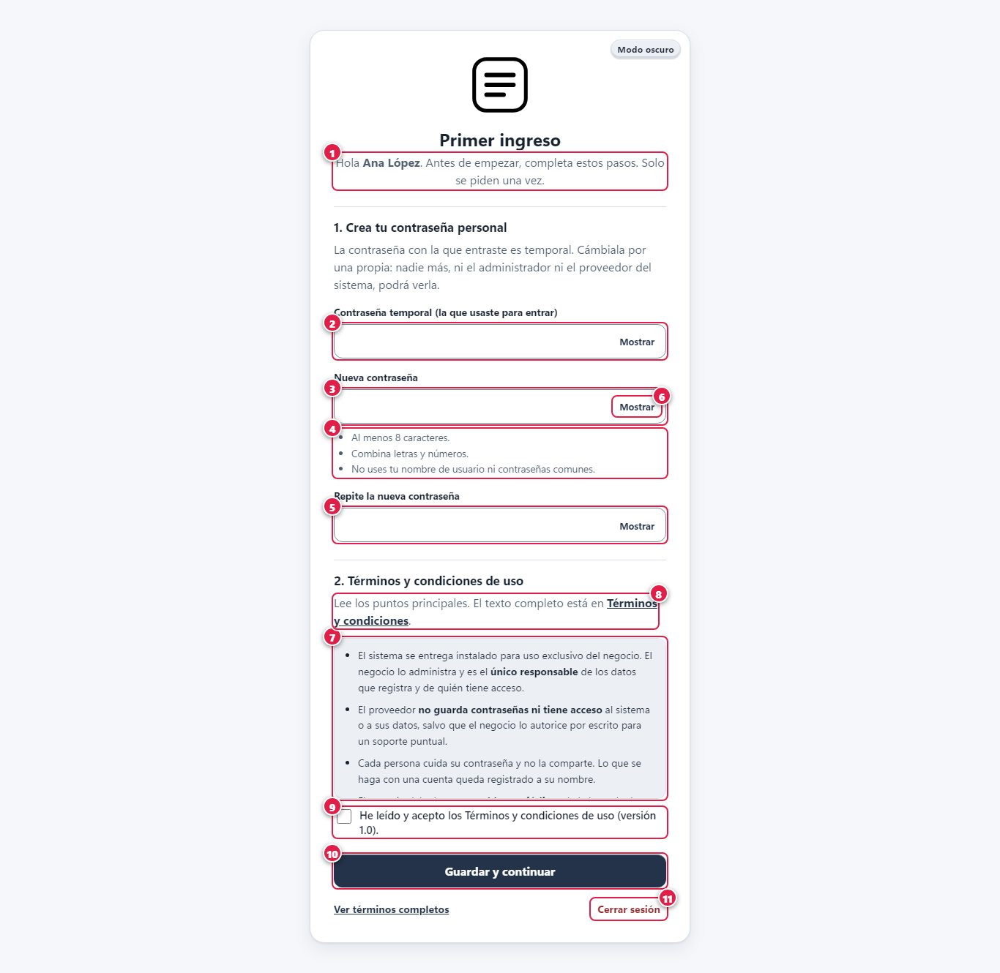

*Primer ingreso: contraseña personal y términos*

| N.º | Elemento | Para qué sirve |
| :-: | --- | --- |
| **1** | Saludo | Confirma con qué cuenta entraste. Este paso solo aparece una vez. |
| **2** | Contraseña temporal | La contraseña con la que acabas de entrar (la que te entregaron). |
| **3** | Nueva contraseña | Tu contraseña personal y secreta. |
| **4** | Requisitos | Mínimo 8 caracteres, combinar letras y números, sin tu nombre de usuario ni contraseñas comunes. |
| **5** | Repetir contraseña | Escríbela otra vez para evitar errores de tipeo. |
| **6** | Mostrar | Muestra u oculta lo escrito en cada campo. |
| **7** | Resumen de los términos | Los puntos principales de los Términos y condiciones de uso. |
| **8** | Términos completos | Abre el texto completo en otra pestaña. |
| **9** | Aceptación | Marca la casilla para aceptar. Sin aceptar no se puede continuar. |
| **10** | Guardar y continuar | Guarda tu contraseña, registra la aceptación y te lleva a tu pantalla. |
| **11** | Cerrar sesión | Sale sin completar; se pedirá de nuevo en el próximo ingreso. |

**Paso a paso:**

1. En **Contraseña temporal** (2) escribe la contraseña con la que acabas de entrar.
2. En **Nueva contraseña** (3) escribe una contraseña que solo tú conozcas y que cumpla los requisitos (4).
3. Repítela en (5).
4. Lee el resumen (7). Si quieres el texto completo, toca el enlace (8).
5. Marca la casilla (9) y pulsa **Guardar y continuar** (10).

Desde ese momento solo tú conoces tu contraseña: ni el administrador ni el proveedor pueden verla.

### Términos y condiciones de uso

Puedes consultarlos en cualquier momento desde el enlace de la pantalla de ingreso o desde tu menú de sesión.

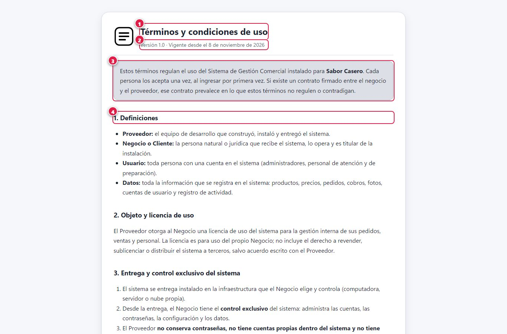

*Términos y condiciones de uso*

| N.º | Elemento | Para qué sirve |
| :-: | --- | --- |
| **1** | Título | Nombre del documento. |
| **2** | Versión y vigencia | Si la versión cambia, el sistema pedirá aceptarla otra vez. |
| **3** | Alcance | A quién aplica y relación con el contrato firmado, si existe. |
| **4** | Secciones | Cláusulas numeradas: control del sistema, datos, cuentas, respaldos, impuestos, garantía y responsabilidad. |

Puntos clave de los términos:

- El negocio tiene el **control exclusivo** del sistema y es el **único responsable** de los datos que registra y de quién tiene acceso.
- El proveedor **no tiene acceso remoto** ni conserva contraseñas. Solo puede revisar el sistema si el negocio lo autoriza **por escrito** para un soporte puntual.
- Lo que se hace con cada cuenta queda registrado a su nombre en **Actividad**.
- El negocio debe hacer **respaldos** periódicos.
- Los reportes son de **control interno**: el sistema **no emite facturas** ni reemplaza obligaciones tributarias.
- Si los términos cambian, el sistema pedirá aceptar la nueva versión.

---

## 4. Panel de administración

Es la pantalla del dueño o encargado. A la izquierda está el menú con todas las secciones; en el celular se abre con el botón **Menú** (☰).

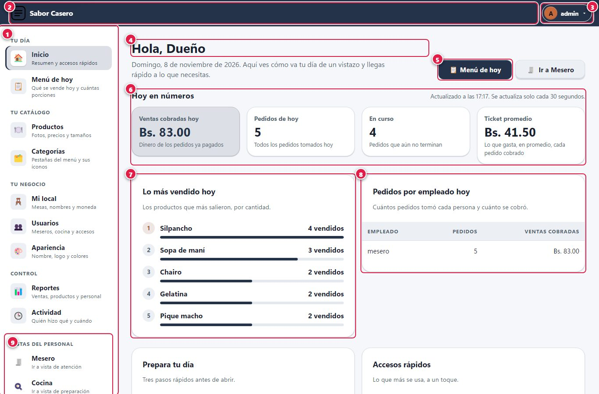

*Panel de administración: Inicio*

| N.º | Elemento | Para qué sirve |
| :-: | --- | --- |
| **1** | Menú de administración | Secciones agrupadas: Tu día, Tu catálogo, Tu negocio y Control. |
| **2** | Logo y nombre | Vuelve al Inicio desde cualquier sección. |
| **3** | Menú de sesión | Cambiar de vista, modo claro/oscuro, cambiar tu contraseña, términos y cerrar sesión. |
| **4** | Saludo | Muestra tu nombre. |
| **5** | Accesos principales | Ir directo a Menú de hoy o a la vista de atención. |
| **6** | Hoy en números | Ventas cobradas, pedidos, ticket promedio y pendientes del día. Se actualiza solo. |
| **7** | Lo más vendido hoy | Los productos con más unidades vendidas. |
| **8** | Pedidos por empleado | Cuántos pedidos registró cada persona hoy. |
| **9** | Vistas del personal | Abre las pantallas de atención, preparación y catálogo. |

### Menú de sesión

El círculo con tu inicial (arriba a la derecha) abre tu menú de sesión. Está en todas las pantallas, también en las del personal.

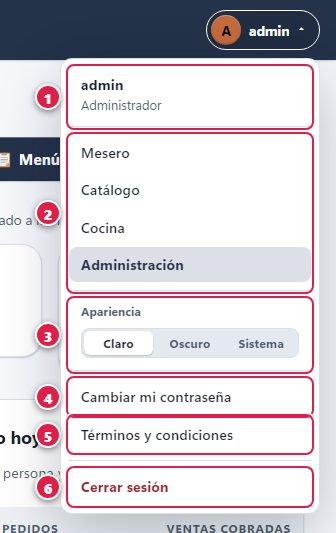

*Menú de sesión*

| N.º | Elemento | Para qué sirve |
| :-: | --- | --- |
| **1** | Tu cuenta | Usuario y rol con los que entraste. |
| **2** | Vistas disponibles | Cambia entre las pantallas que tu rol puede usar. |
| **3** | Apariencia | Claro, Oscuro o según el Sistema. Se recuerda en este dispositivo. |
| **4** | Cambiar mi contraseña | Cambia tu contraseña cuando quieras. |
| **5** | Términos y condiciones | Consulta el texto que aceptaste. |
| **6** | Cerrar sesión | Sal siempre al terminar, sobre todo en equipos compartidos. |

### Orden recomendado la primera vez

1. **Apariencia:** nombre, logo y colores de tu negocio.
2. **Mi local:** cantidad de mesas, cómo las llamas y tu moneda.
3. **Categorías:** revisa las de ejemplo; renómbralas, ordénalas u oculta las que no uses.
4. **Productos:** carga lo que vendes, idealmente con foto.
5. **Usuarios:** crea una cuenta para cada persona de tu equipo.
6. **Menú de hoy:** elige qué vendes hoy y publícalo.

> **No pierdes lo que escribes:** si dejas un formulario a medias y cambias de sección, al volver aparece «Recuperamos lo que estabas escribiendo». Puedes continuar o pulsar **Descartar**. Antes de guardar algo importante, el sistema muestra un resumen y pide confirmación.

---

## 5. Menú de hoy

Aquí decides **qué se vende hoy** y **cuántas porciones** hay. Hazlo cada mañana antes de abrir.

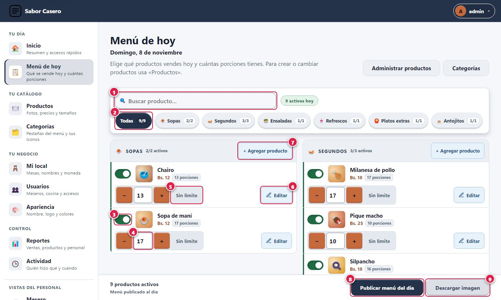

*Menú de hoy*

| N.º | Elemento | Para qué sirve |
| :-: | --- | --- |
| **1** | Buscar | Encuentra un producto por su nombre. |
| **2** | Filtrar por categoría | Muestra solo una categoría. El número indica activos / total. |
| **3** | Vender hoy | Activa o desactiva el producto en el menú del día. |
| **4** | Porciones | Cuántas porciones hay. Ajusta con − y +. Al llegar a cero el producto se agota. |
| **5** | Sin límite / Poner límite | Decide si el producto tiene porciones contadas o se vende sin límite. |
| **6** | Editar | Abre el producto para cambiar foto, precio o datos. |
| **7** | Agregar producto | Crea un producto nuevo en esa categoría. |
| **8** | Publicar menú del día | Hace visibles los cambios para tu personal. Hasta publicar, siguen viendo el menú anterior. |
| **9** | Descargar imagen | Genera una imagen del menú para compartir por WhatsApp o redes. |

**Cómo preparar el día:**

1. Activa con el interruptor (3) cada producto que venderás hoy.
2. Ajusta las porciones (4). Si un producto no se agota nunca (por ejemplo, refrescos en botella), pulsa **Sin límite** (5).
3. Pulsa **Publicar menú del día** (8) y confirma.

Mientras no publiques, verás el aviso «Cambios sin publicar» y tu personal seguirá viendo el menú anterior. Cuando un producto llega a cero porciones durante el día, aparece como **Agotado** para tu personal automáticamente.

---

## 6. Productos y fotos

Todo lo que vendes, con foto, descripción, categoría, precio y tamaños.

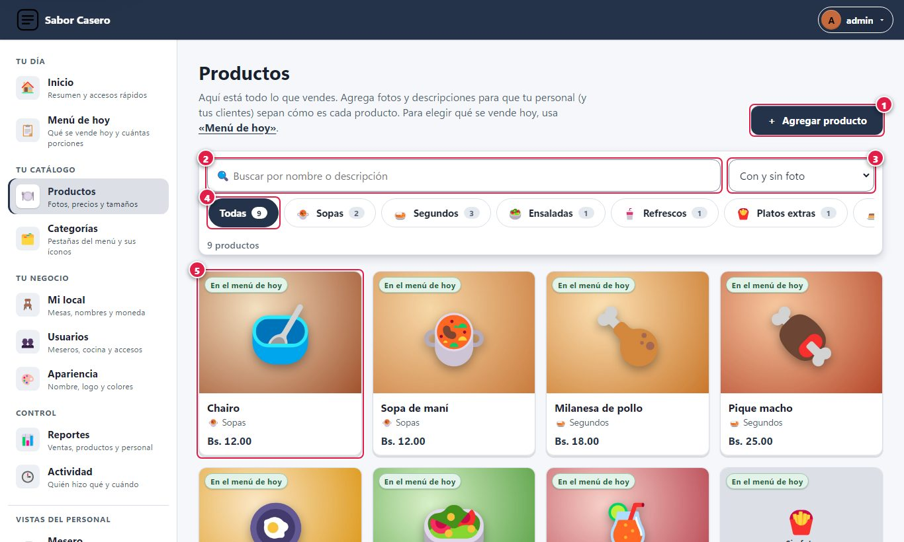

*Productos*

| N.º | Elemento | Para qué sirve |
| :-: | --- | --- |
| **1** | Agregar producto | Crea un producto nuevo. |
| **2** | Buscar | Por nombre o descripción. |
| **3** | Filtro de foto | Muestra solo productos con foto o sin foto. |
| **4** | Categorías | Filtra por categoría. |
| **5** | Tarjeta del producto | Foto, estado de hoy, nombre, categoría y precio. Tócala para editar. |

Al tocar un producto (o **Agregar producto**) se abre su ficha:

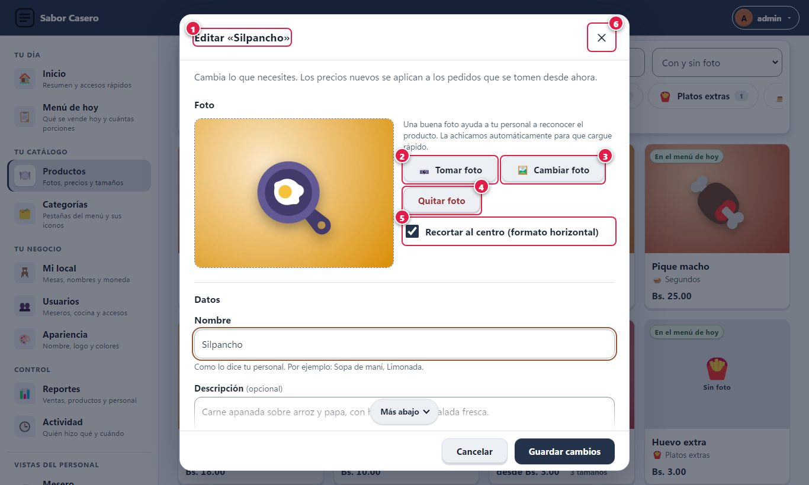

*Editar producto: foto*

| N.º | Elemento | Para qué sirve |
| :-: | --- | --- |
| **1** | Título | Producto que estás editando. |
| **2** | Tomar foto | Abre la cámara del celular o tablet. |
| **3** | Elegir / Cambiar foto | Sube una imagen guardada (PNG, JPG o WebP). El sistema la endereza y la achica para que cargue rápido. |
| **4** | Quitar foto | Elimina la foto actual (pide confirmación). |
| **5** | Recortar al centro | Recorta la foto en formato horizontal para que todas se vean iguales. |
| **6** | Cerrar | Cierra sin guardar (pide confirmación si hiciste cambios). |

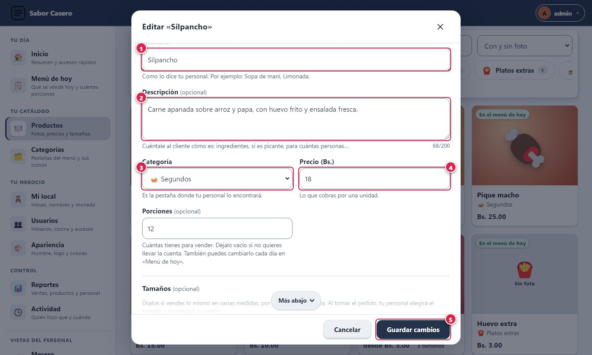

*Editar producto: datos*

| N.º | Elemento | Para qué sirve |
| :-: | --- | --- |
| **1** | Nombre | Como lo conoce tu personal y tu cliente. |
| **2** | Descripción | Opcional. Se muestra en el catálogo para el cliente. |
| **3** | Categoría | Pestaña del menú en la que aparece. |
| **4** | Precio | Precio de venta. No cambia el de pedidos ya registrados. |
| **5** | Guardar cambios | Guarda después de mostrar un resumen para confirmar. |

Más abajo en la misma ficha están:

- **Porciones (opcional):** cantidad inicial para vender.
- **Tamaños (opcional):** por ejemplo Vaso / Jarra o Normal / Doble, cada uno con su precio y, si quieres, solo para mesa o solo para llevar.
- **Eliminar producto:** si el producto ya tiene ventas, el sistema lo **archiva** en lugar de borrarlo, para no perder el historial.

> **Consejo para las fotos:** toma la foto con buena luz, de frente y con el plato centrado. El sistema la recorta y la achica para que cargue rápido en los celulares.

---

## 7. Categorías

Las categorías son las **pestañas** que ve tu personal al tomar un pedido (Sopas, Segundos, Bebidas…), en el orden que definas aquí.

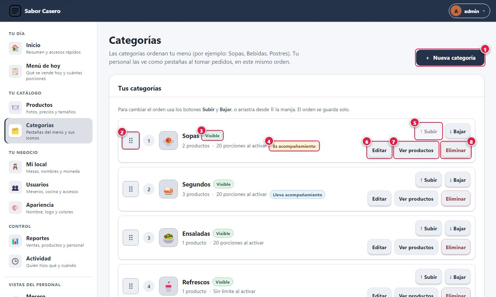

*Categorías*

| N.º | Elemento | Para qué sirve |
| :-: | --- | --- |
| **1** | Nueva categoría | Crea una pestaña nueva para el menú. |
| **2** | Arrastrar | Mantén presionado y arrastra para cambiar el orden. |
| **3** | Visible | Indica si el personal ve la categoría. |
| **4** | Acompañamiento | Si sus productos sirven como acompañamiento o si llevan uno. |
| **5** | Subir / Bajar | Otra forma de ordenar, botón por botón. |
| **6** | Editar | Nombre, ícono, visibilidad, porciones sugeridas y acompañamientos. |
| **7** | Ver productos | Abre Productos filtrado por esta categoría. |
| **8** | Eliminar | Si tiene productos, pide a qué categoría moverlos. |

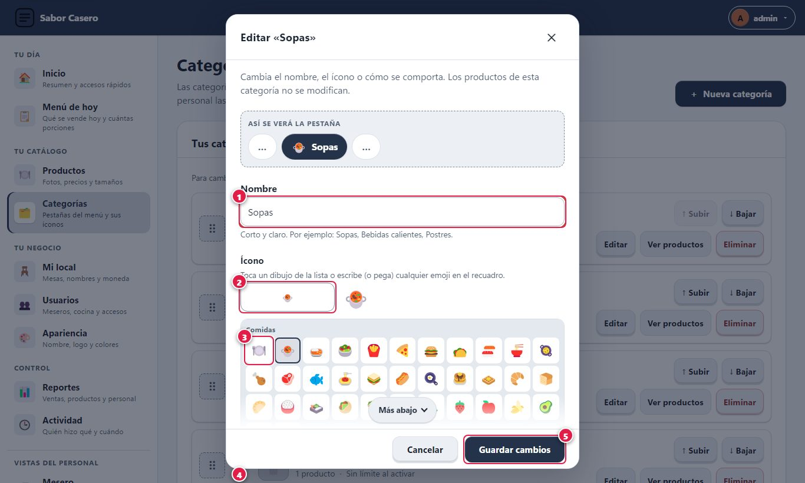

*Editar categoría*

| N.º | Elemento | Para qué sirve |
| :-: | --- | --- |
| **1** | Nombre | Corto y claro: Sopas, Bebidas, Postres… |
| **2** | Ícono | Escribe o pega un emoji. |
| **3** | Íconos sugeridos | Toca uno para elegirlo. |
| **4** | Visible para el personal | Ocúltala sin borrar sus productos. |
| **5** | Guardar cambios | Aplica los cambios. |

Más abajo en la ficha de la categoría también configuras:

- **Porciones sugeridas:** cantidad que se propone al activar un producto de esta categoría en el Menú de hoy.
- **Acompañamientos** (dos opciones que no pueden ir juntas):
  - *Sus productos pueden llevar un acompañamiento:* al pedir uno, el mesero elige el acompañamiento (por ejemplo, el segundo con su sopa).
  - *Sus productos sirven como acompañamiento:* aparecen como opción (por ejemplo, las sopas).

Al **eliminar** una categoría con productos, el sistema pregunta a qué categoría moverlos.

---

## 8. Mi local

Datos de tu local que el personal ve en sus pantallas.

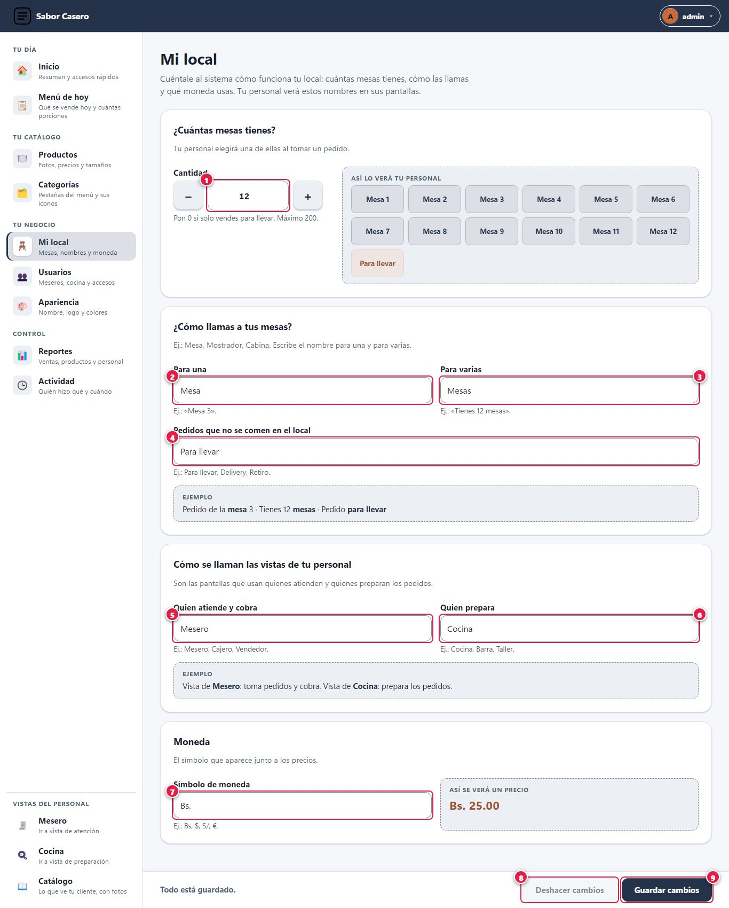

*Mi local*

| N.º | Elemento | Para qué sirve |
| :-: | --- | --- |
| **1** | Cantidad de mesas | Cuántas mesas o puntos de atención tienes (0 si solo vendes para llevar). |
| **2** | Nombre en singular | Cómo llamas a una mesa: Mesa, Cabina, Mostrador… |
| **3** | Nombre en plural | Mesas, Cabinas… |
| **4** | Para llevar | Cómo se llama la venta para llevar. |
| **5** | Nombre de la vista de atención | Por ejemplo Mesero, Cajero, Atención. |
| **6** | Nombre de la vista de preparación | Por ejemplo Cocina, Barra, Taller. |
| **7** | Moneda | Símbolo que acompaña a los precios (Bs., $, S/…). |
| **8** | Deshacer cambios | Vuelve a los valores guardados. |
| **9** | Guardar cambios | Guarda y aplica los nombres en todas las pantallas. |

---

## 9. Usuarios: las cuentas de tu personal

Cada persona debe tener **su propia cuenta**. Nunca compartas una cuenta entre varias personas: el sistema registra quién hizo cada cosa.

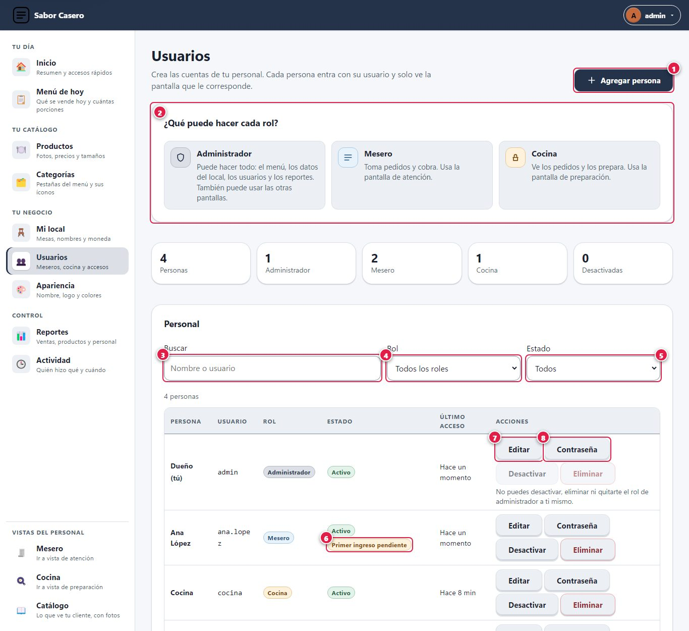

*Usuarios*

| N.º | Elemento | Para qué sirve |
| :-: | --- | --- |
| **1** | Agregar persona | Crea la cuenta de un nuevo integrante del personal. |
| **2** | Qué puede hacer cada rol | Resumen de permisos de Administrador, Atención y Preparación. |
| **3** | Buscar | Por nombre o usuario. |
| **4** | Filtrar por rol | — |
| **5** | Filtrar por estado | Activos o desactivados. |
| **6** | Primer ingreso pendiente | La persona todavía no cambió su contraseña temporal ni aceptó los términos. |
| **7** | Editar | Nombre, rol y estado (activo / desactivado). |
| **8** | Contraseña | Asigna una contraseña temporal a quien la olvidó. |

### Agregar a una persona

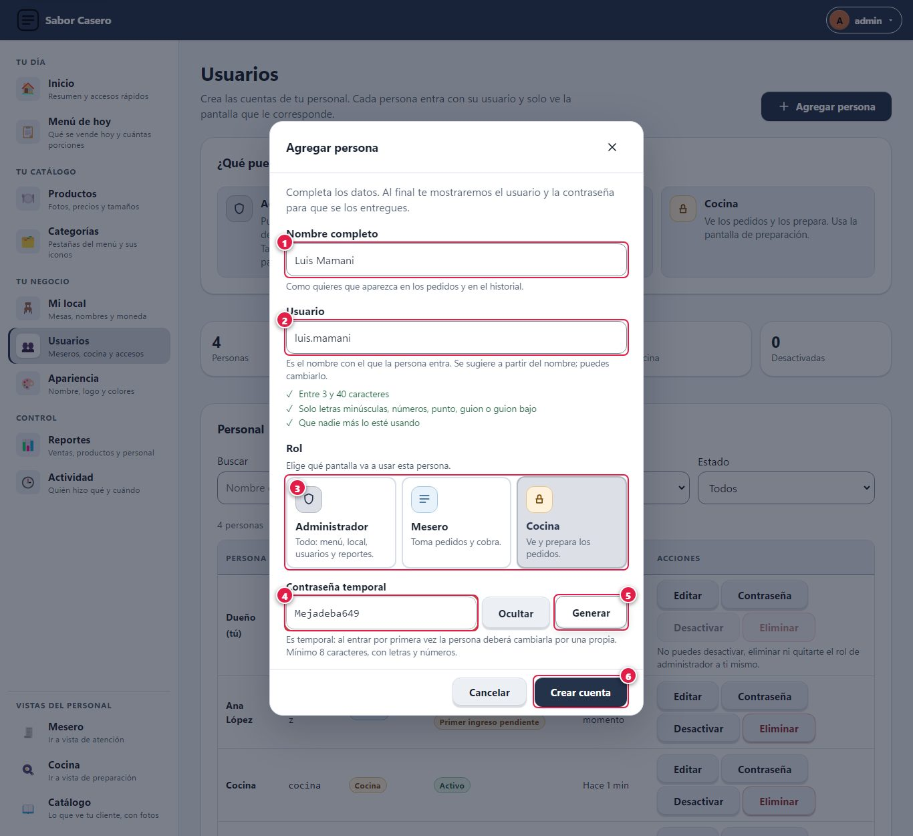

*Agregar persona*

| N.º | Elemento | Para qué sirve |
| :-: | --- | --- |
| **1** | Nombre completo | Nombre de la persona. El usuario se sugiere solo. |
| **2** | Usuario | Con el que entrará. Solo minúsculas, números, punto, guion o guion bajo. |
| **3** | Rol | Administrador, Atención o Preparación. Toca la tarjeta que corresponda. |
| **4** | Contraseña temporal | La persona deberá cambiarla en su primer ingreso. |
| **5** | Generar | Crea una contraseña segura automáticamente. |
| **6** | Crear cuenta | Muestra un resumen, crea la cuenta y enseña las credenciales una sola vez. |

1. Escribe el nombre completo (1); el usuario (2) se sugiere solo.
2. Elige el rol (3).
3. Pulsa **Generar** (5) para crear una contraseña temporal segura.
4. Pulsa **Crear cuenta** (6) y confirma.
5. El sistema muestra el usuario y la contraseña **una sola vez**: cópialos y entrégaselos a la persona en privado.
6. Cuando la persona entre por primera vez, deberá crear su propia contraseña y aceptar los términos (sección 3). Mientras tanto verás la etiqueta **Primer ingreso pendiente**.

### Otras acciones

| Acción | Cuándo usarla |
| --- | --- |
| **Editar** | Cambiar nombre, rol o estado. |
| **Contraseña** | La persona olvidó su contraseña. Le asignas una **temporal** y, al entrar, deberá cambiarla. |
| **Desactivar** | La persona deja de trabajar contigo. Ya no puede entrar, pero su historial se conserva. **Es la opción recomendada.** |
| **Eliminar** | Borra la cuenta; su nombre se mantiene en el historial. |

- Si desactivas a alguien, le cambias el rol o le asignas una contraseña, **su sesión se cierra de inmediato** en su dispositivo.
- No puedes desactivarte ni eliminarte a ti mismo, y siempre debe quedar al menos un administrador activo.
- **Recomendación:** ten al menos **dos administradores** (por ejemplo, el dueño y un encargado de confianza). Si uno olvida su contraseña, el otro puede asignarle una temporal.

---

## 10. Apariencia

Personaliza cómo se ve el sistema para tu negocio y tus clientes.

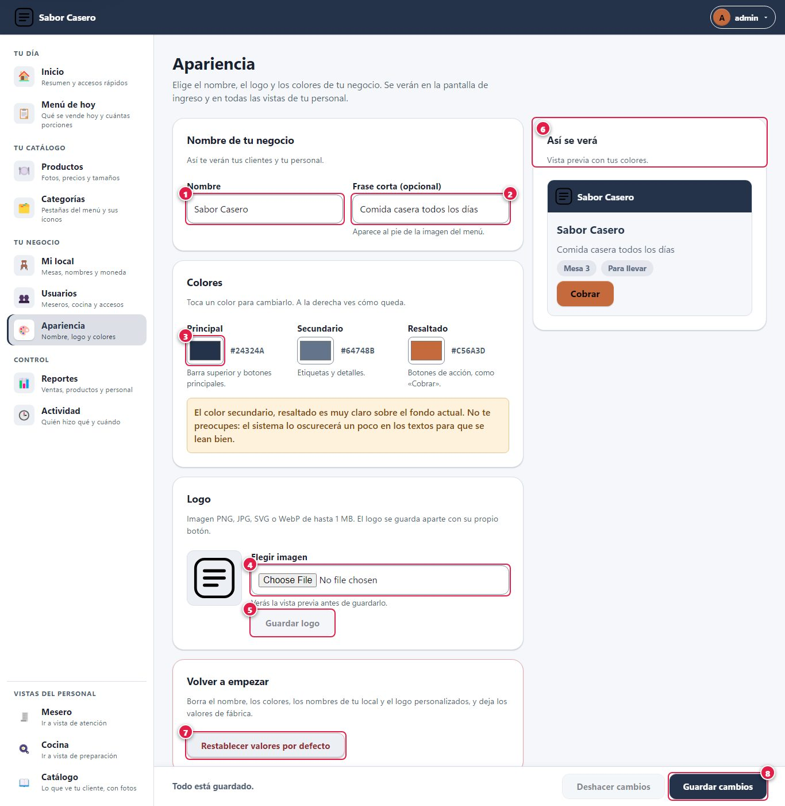

*Apariencia*

| N.º | Elemento | Para qué sirve |
| :-: | --- | --- |
| **1** | Nombre del negocio | Aparece en todas las pantallas y en el ingreso. |
| **2** | Eslogan | Frase corta opcional bajo el nombre. |
| **3** | Colores | Primario, secundario y de acento. El sistema ajusta el contraste en claro y oscuro. |
| **4** | Logo | PNG, JPG, SVG o WebP de hasta 1 MB. |
| **5** | Guardar logo | Sube el logo elegido. |
| **6** | Vista previa | Cómo se verá antes de guardar. |
| **7** | Restablecer | Vuelve a nombre, colores y logo por defecto (pide confirmación). |
| **8** | Guardar cambios | Aplica nombre, eslogan y colores. |

---

## 11. Reportes

Elige un período y revisa cómo te fue.

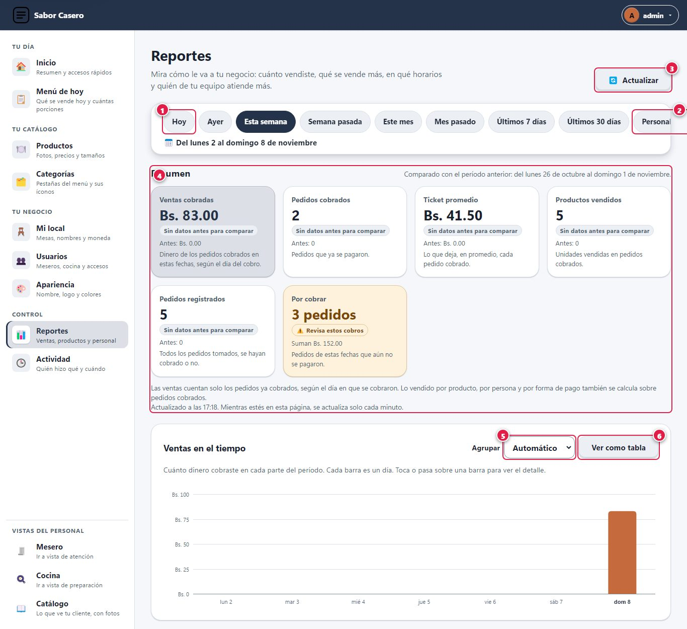

*Reportes: período y resumen*

| N.º | Elemento | Para qué sirve |
| :-: | --- | --- |
| **1** | Períodos rápidos | Hoy, Ayer, Esta semana, Mes pasado, Últimos 30 días… |
| **2** | Personalizado | Elige fecha de inicio y fin. |
| **3** | Actualizar | Vuelve a calcular con los datos más recientes. |
| **4** | Resumen | Ventas cobradas, pedidos, ticket promedio, productos y por cobrar, comparados con el período anterior. |
| **5** | Agrupar | Ver las ventas por día, semana o mes. |
| **6** | Ver como tabla | Muestra los mismos datos en una tabla. |

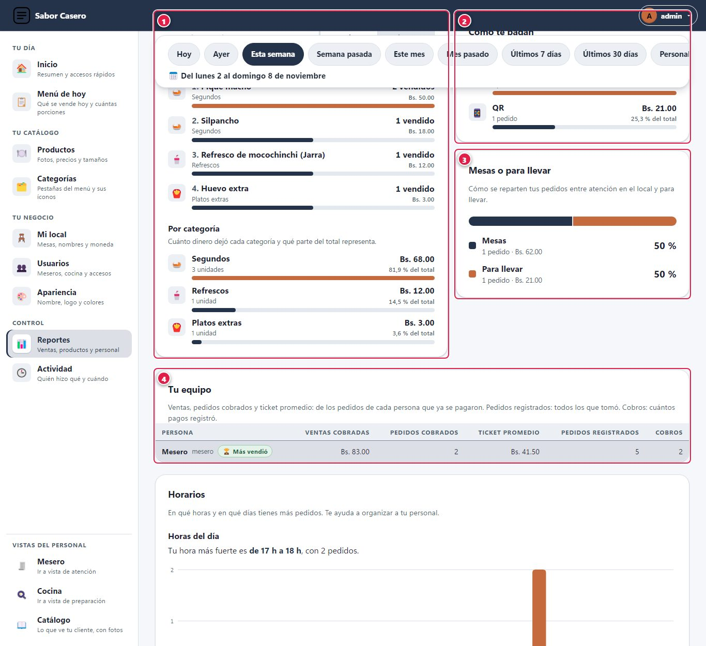

*Reportes: productos, pagos y equipo*

| N.º | Elemento | Para qué sirve |
| :-: | --- | --- |
| **1** | Lo más vendido | Ranking por unidades o por ingresos, y aporte de cada categoría. |
| **2** | Cómo te pagan | Efectivo, QR, tarjeta. |
| **3** | Mesa o para llevar | Cómo se reparten los pedidos. |
| **4** | Tu equipo | Ventas y cobros por persona. |

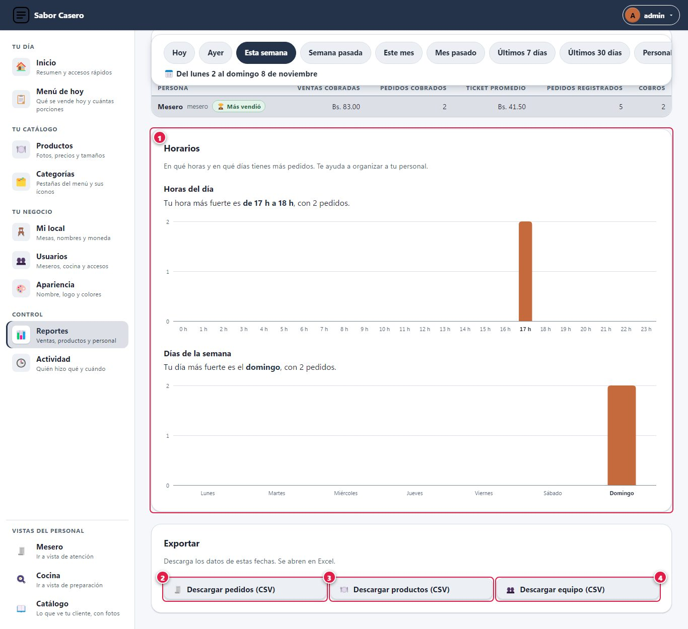

*Reportes: horarios y exportación*

| N.º | Elemento | Para qué sirve |
| :-: | --- | --- |
| **1** | Horarios | Horas y días con más pedidos. |
| **2** | Exportar pedidos | Archivo CSV que se abre en Excel. |
| **3** | Exportar productos | — |
| **4** | Exportar equipo | — |

**Cómo se calculan:**

- Las **ventas** cuentan solo pedidos **cobrados**, según el día en que se cobraron.
- **Por cobrar** son los pedidos del período que todavía no se pagaron.
- Cada indicador muestra una flecha que compara con el período anterior.
- Los archivos CSV se abren directamente en Excel.

> Los reportes son de control interno y **no reemplazan** tus registros contables ni tributarios.

---

## 12. Actividad

Registro de **quién hizo qué y cuándo**: pedidos, cobros, cambios de menú, productos, configuración, usuarios, ingresos al sistema, intentos fallidos, cambios de contraseña y aceptación de términos.

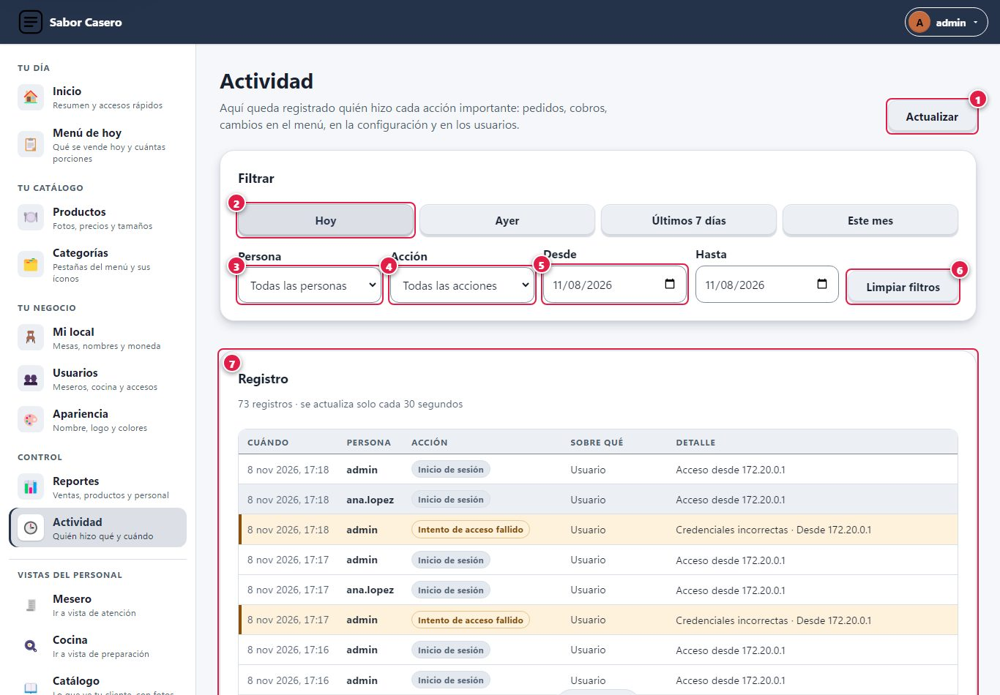

*Actividad*

| N.º | Elemento | Para qué sirve |
| :-: | --- | --- |
| **1** | Actualizar | Recarga el registro (también se actualiza solo). |
| **2** | Atajos de fecha | Hoy, Ayer, Últimos 7 días, Este mes. |
| **3** | Persona | Filtra por quién hizo la acción. |
| **4** | Tipo de acción | Pedidos, cobros, cambios de menú, usuarios, ingresos, intentos fallidos… |
| **5** | Rango de fechas | Desde y hasta. |
| **6** | Limpiar filtros | — |
| **7** | Registro | Fecha y hora, persona, acción y detalle. No se puede editar ni borrar desde el sistema. |

Úsalo para aclarar dudas («¿quién cambió este precio?», «¿quién cobró la mesa 4?») o detectar intentos de ingreso sospechosos.

---

## 13. Cambiar mi contraseña

Cualquier persona puede cambiar su contraseña cuando quiera desde su menú de sesión → **Cambiar mi contraseña**.

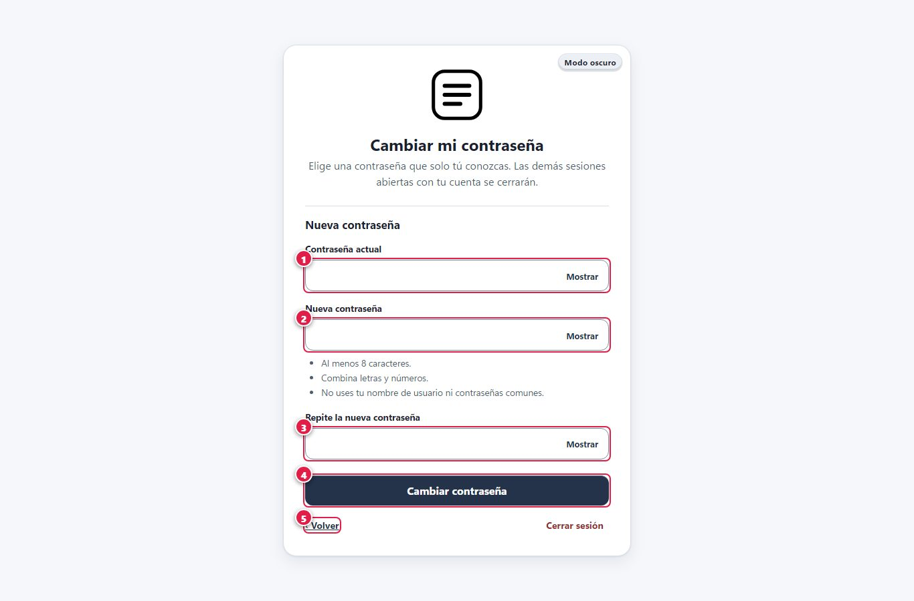

*Cambiar mi contraseña*

| N.º | Elemento | Para qué sirve |
| :-: | --- | --- |
| **1** | Contraseña actual | Por seguridad se pide la que usas hoy. |
| **2** | Nueva contraseña | Cumple los requisitos de la lista. |
| **3** | Repetir | — |
| **4** | Cambiar contraseña | Guarda y cierra las demás sesiones abiertas con tu cuenta. |
| **5** | Volver | Regresa a tu pantalla sin cambiar nada. |

Al cambiarla, se cierran las demás sesiones abiertas con tu cuenta (por ejemplo, si la dejaste abierta en otro celular).

---

## 14. Atención (mesero): tomar, cobrar y entregar pedidos

Pantalla pensada para el celular.

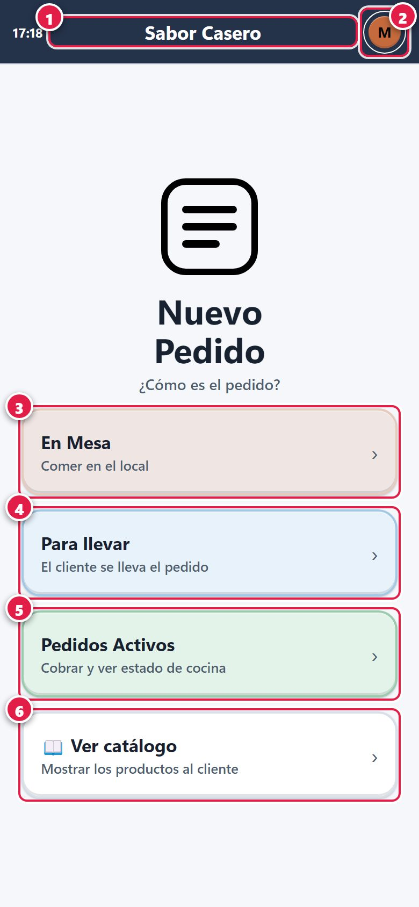

*Atención: inicio*

| N.º | Elemento | Para qué sirve |
| :-: | --- | --- |
| **1** | Negocio | Logo y nombre. |
| **2** | Menú de sesión | Apariencia, cambiar contraseña y cerrar sesión. |
| **3** | En mesa | Pedido para comer en el local. |
| **4** | Para llevar | Pedido con el nombre del cliente. |
| **5** | Pedidos activos | Ver estado, cobrar, entregar o agregar productos. |
| **6** | Ver catálogo | Muestra los productos con fotos al cliente. |

### Tomar un pedido en mesa

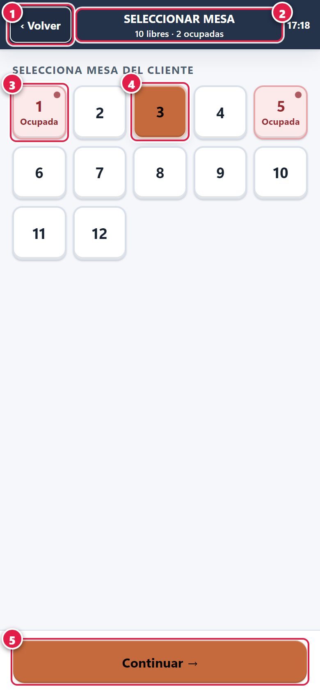

*Atención: elegir mesa*

| N.º | Elemento | Para qué sirve |
| :-: | --- | --- |
| **1** | Volver | — |
| **2** | Mesas libres y ocupadas | Resumen en tiempo real. |
| **3** | Mesa ocupada | Ya tiene un pedido abierto. |
| **4** | Mesa elegida | Toca una mesa libre para elegirla. |
| **5** | Continuar | Pasa al menú. |

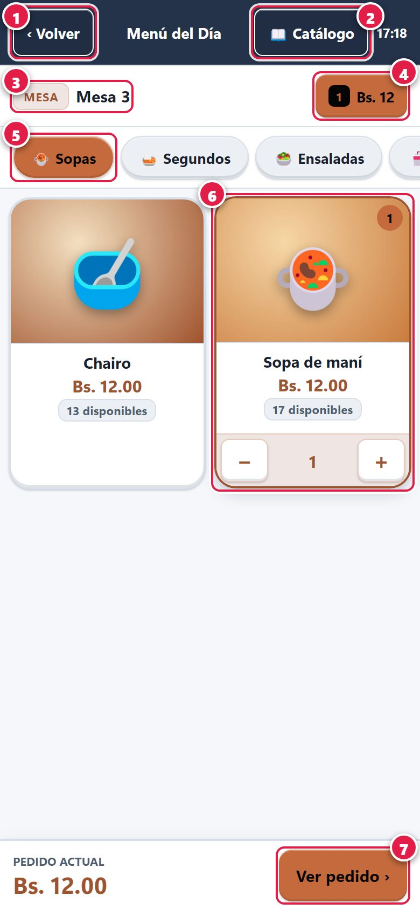

*Atención: menú*

| N.º | Elemento | Para qué sirve |
| :-: | --- | --- |
| **1** | Volver | — |
| **2** | Catálogo | Muestra fotos al cliente sin perder el pedido. |
| **3** | Mesa del pedido | Para quién es el pedido. |
| **4** | Resumen del pedido | Cantidad de productos y total. Tócalo para ver el pedido. |
| **5** | Categorías | Desliza para ver todas las pestañas. |
| **6** | Producto | Un toque agrega 1. Con − y + ajustas la cantidad. |
| **7** | Ver pedido | Abre el pedido para revisarlo y enviarlo. |

- **Producto simple:** un toque agrega 1; con **−** y **+** ajustas la cantidad sin abrir nada.
- **Producto con opciones** (tamaño o acompañamiento): se abre un panel.

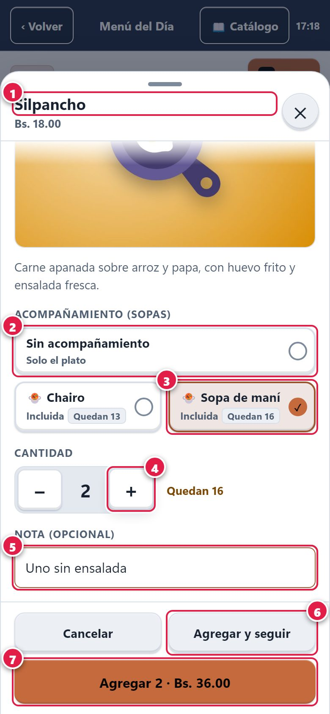

*Atención: producto con opciones*

| N.º | Elemento | Para qué sirve |
| :-: | --- | --- |
| **1** | Producto | Nombre y precio. |
| **2** | Sin acompañamiento | Solo el plato. |
| **3** | Acompañamiento | Elige la opción; muestra cuántas quedan. |
| **4** | Cantidad | Cuántas unidades con esta combinación. |
| **5** | Nota | Indicaciones para la cocina: sin cebolla, para el niño… |
| **6** | Agregar y seguir | Agrega y deja el panel abierto para otra combinación. |
| **7** | Agregar | Agrega y cierra el panel. |

> **Ejemplo:** una familia pide 2 silpanchos con sopa y 1 sin sopa. Toca Silpancho → elige la sopa → cantidad 2 → **Agregar y seguir** (6) → elige «Sin acompañamiento» → cantidad 1 → **Agregar** (7).

### Revisar y enviar

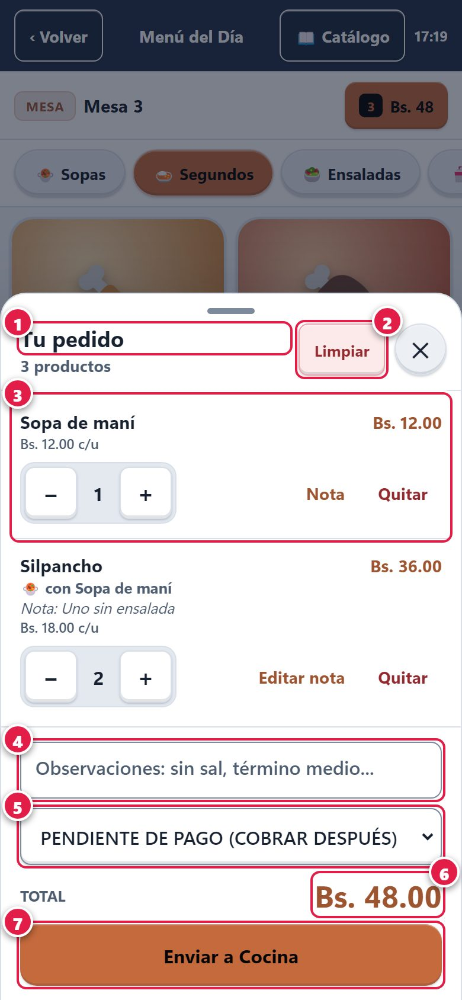

*Atención: revisar y enviar el pedido*

| N.º | Elemento | Para qué sirve |
| :-: | --- | --- |
| **1** | Tu pedido | Mesa o cliente y cantidad de productos. |
| **2** | Limpiar | Vacía el pedido (pide confirmación). |
| **3** | Líneas del pedido | Cantidad, opciones, notas y subtotal. Puedes cambiar cantidades o quitar. |
| **4** | Observaciones | Indicaciones generales del pedido. |
| **5** | Pago | Cobrar después o marcar pagado al instante (efectivo, QR o tarjeta). |
| **6** | Total | — |
| **7** | Enviar a cocina | Muestra un resumen para confirmar y lo envía a preparación. |

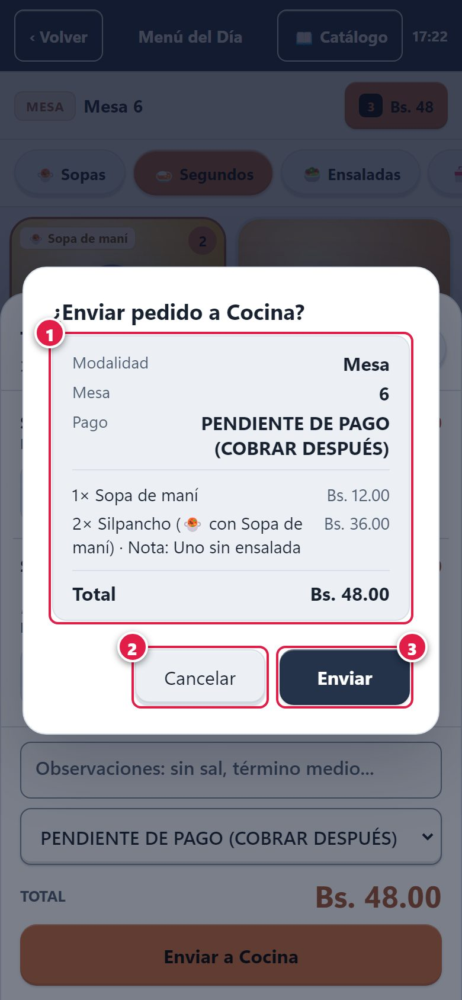

*Atención: confirmar envío*

| N.º | Elemento | Para qué sirve |
| :-: | --- | --- |
| **1** | Resumen | Revisa productos, cantidades y total antes de enviar. |
| **2** | Cancelar | Vuelve al pedido sin enviarlo. |
| **3** | Enviar | Confirma y envía el pedido a preparación. |

Después de enviar verás «¡Enviado!». La cocina recibe el pedido al instante con un aviso sonoro.

### Para llevar

En la pantalla de inicio elige **Para llevar**, escribe el nombre del cliente y continúa igual que en mesa.

### Pedidos activos: cobrar, entregar y agregar

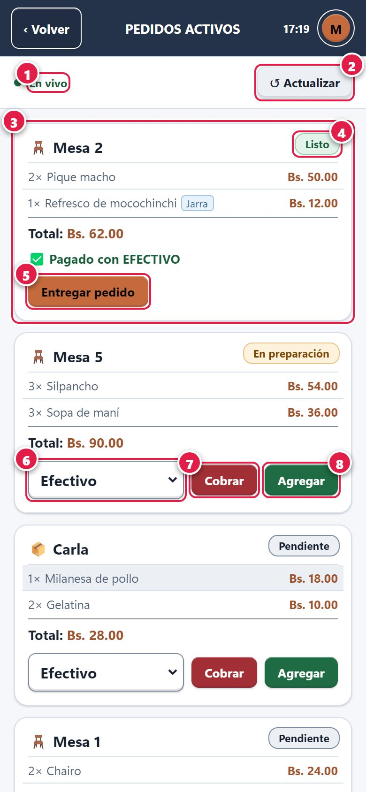

*Atención: pedidos activos*

| N.º | Elemento | Para qué sirve |
| :-: | --- | --- |
| **1** | En vivo | La lista se actualiza sola cuando cocina cambia un estado. |
| **2** | Actualizar | — |
| **3** | Pedido | Mesa o cliente, productos y total. |
| **4** | Estado | Pendiente, En preparación, Listo o Entregado. |
| **5** | Entregar pedido | Cuando está Listo y ya lo llevaste. |
| **6** | Forma de pago | Efectivo, QR o tarjeta. |
| **7** | Cobrar | Registra el pago (pide confirmación). |
| **8** | Agregar | Suma productos a un pedido no pagado. |

- Puedes **cobrar** antes o después de entregar.
- **Entregar** se habilita cuando la cocina marca el pedido como **Listo**.
- **Agregar** suma productos a un pedido que todavía no se pagó; si ya estaba listo o entregado, vuelve a cocina como pendiente y los productos nuevos aparecen marcados.
- El pedido desaparece de la lista cuando está **entregado y cobrado**.

---

## 15. Catálogo para el cliente

Muestra tus productos de hoy con fotos grandes, descripción, precio y disponibilidad. El mesero lo abre con **📖 Catálogo** sin perder el pedido; en una tablet puedes dejarlo en pantalla completa.

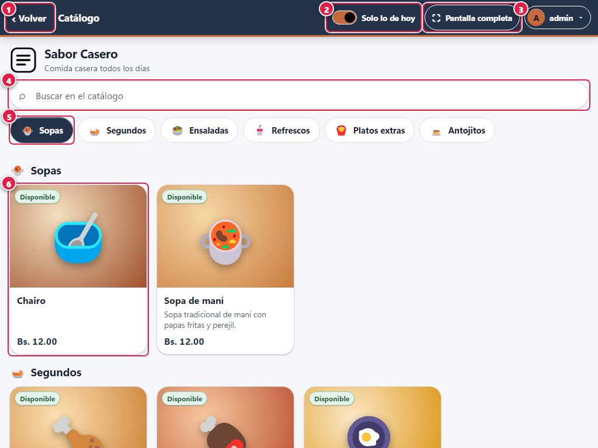

*Catálogo para el cliente*

| N.º | Elemento | Para qué sirve |
| :-: | --- | --- |
| **1** | Volver | Regresa a la pantalla anterior. |
| **2** | Solo lo de hoy | Solo para administradores: apágalo para ver todo el catálogo. |
| **3** | Pantalla completa | Ideal para dejar el catálogo en una tablet. |
| **4** | Buscar | Encuentra un producto. |
| **5** | Categorías | Salta a una categoría. |
| **6** | Producto | Foto, disponibilidad y precio. Tócalo para ver la descripción y los tamaños. |

Al tocar un producto se ve su descripción y sus tamaños; **Agregar al pedido** lo lleva directo al pedido que está tomando el mesero.

---

## 16. Preparación (cocina)

Tablero en tres columnas que se actualiza solo.

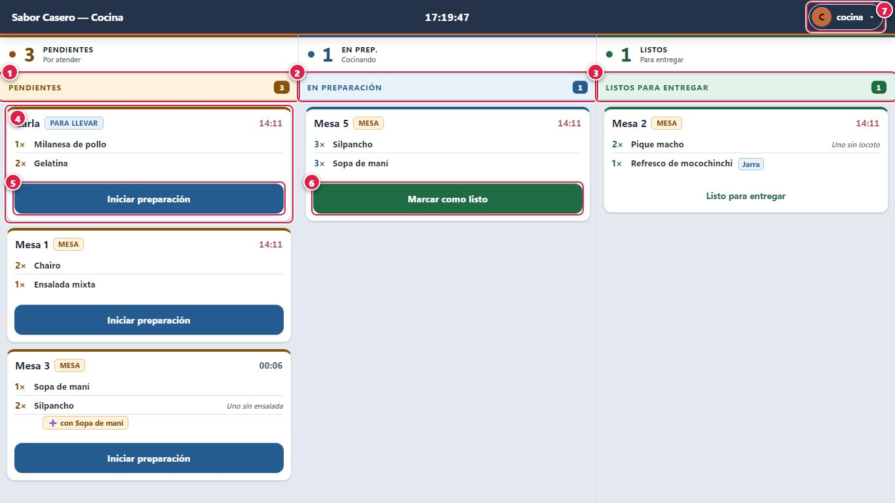

*Preparación (cocina)*

| N.º | Elemento | Para qué sirve |
| :-: | --- | --- |
| **1** | Pendientes | Pedidos nuevos, del más antiguo al más nuevo. El número indica cuántos hay. |
| **2** | En preparación | — |
| **3** | Listos para entregar | Esperan que el mesero los entregue. |
| **4** | Tarjeta del pedido | Mesa o cliente, tiempo de espera, productos, opciones y notas. |
| **5** | Iniciar preparación | Pasa el pedido a En preparación (tecla P). |
| **6** | Marcar como listo | Avisa al mesero que puede recogerlo (tecla L). |
| **7** | Menú de sesión | — |

1. Cuando llega un pedido suena un aviso y aparece en **Pendientes**.
2. **Iniciar preparación** (5) lo pasa a la columna del medio.
3. **Marcar como listo** (6) avisa al mesero.
4. El pedido sale del tablero cuando el mesero lo marca como entregado.

- Los productos agregados después a un pedido aparecen marcados como **Nuevo**.
- Atajos con teclado: **P** inicia el primer pendiente y **L** marca como listo el primero en preparación.
- Para que suene el aviso, **toca la pantalla una vez** al empezar el turno (los navegadores no permiten sonido hasta que la persona interactúa).

---

## 17. Seguridad y buenas prácticas

| Haz esto | Evita esto |
| --- | --- |
| Usa una contraseña propia, de al menos 8 caracteres, con letras y números. | Usar tu nombre, tu usuario, «12345678» o la misma contraseña de otras cuentas. |
| Cierra sesión al terminar, sobre todo en equipos compartidos. | Dejar la sesión abierta en un celular que usan otras personas. |
| Desactiva de inmediato la cuenta de quien deja de trabajar en el negocio. | Compartir una cuenta entre varias personas. |
| Revisa **Actividad** de vez en cuando. | Anotar contraseñas en lugares visibles. |
| Mantén al menos dos administradores de confianza. | Depender de una sola persona para administrar. |
| Haz (o pide que se haga) un **respaldo diario**. | Apagar la computadora del sistema sin cerrar correctamente. |

**Protecciones que el sistema ya tiene:**

- Cada persona solo ve las pantallas de su rol.
- Las contraseñas se guardan **cifradas**; nadie puede leerlas, ni siquiera desde la base de datos.
- Las contraseñas temporales se deben cambiar en el primer ingreso.
- Bloqueo temporal tras varios intentos fallidos.
- Las sesiones se cierran solas tras un tiempo sin uso y cuando cambia la cuenta.
- Registro de actividad de todas las acciones importantes.

### ¿Y si el administrador pierde el acceso?

1. Si hay **otro administrador**, este le asigna una contraseña temporal en **Usuarios → Contraseña**.
2. Si **no queda ningún administrador** con acceso, la persona que maneja la computadora o servidor donde está instalado el sistema puede emitir una contraseña temporal desde allí (ver [Instalación y mantenimiento → Recuperar el acceso de un administrador](INSTALACION.md#9-recuperar-el-acceso-de-un-administrador)). Este procedimiento solo funciona con acceso físico o administrativo al servidor del negocio: **no existe una «puerta trasera»** del proveedor.

---

## 18. Preguntas frecuentes

**Mi personal no ve un producto.**
Revisa que esté activado en **Menú de hoy** y que hayas pulsado **Publicar**, que tenga porciones disponibles y que su categoría esté **visible**.

**Cambié un precio, ¿afecta pedidos anteriores?**
No. El precio nuevo se aplica a los pedidos que se tomen desde ese momento.

**Un mesero olvidó su contraseña.**
**Usuarios → Contraseña**, genera una temporal y entrégasela. Al entrar deberá cambiarla.

**Me sale «Demasiados intentos».**
Espera los minutos indicados. Si no recuerdas la contraseña, pide una temporal al administrador.

**Me sacó del sistema de repente.**
Pasa si el administrador cambió tu cuenta, si cambiaste tu contraseña en otro dispositivo o tras mucho tiempo sin uso. Vuelve a ingresar.

**¿Se puede anular un pedido?**
Todavía no. Si se registró por error, coordínalo con el encargado; queda constancia en **Actividad**.

**¿Se pierden los datos si se apaga la computadora?**
No: todo se guarda en la base de datos. Aun así, haz respaldos diarios para protegerte de fallas del equipo.

**¿El sistema emite facturas?**
No. Es un sistema de gestión interna de pedidos y ventas; las facturas se emiten con el sistema autorizado por la administración tributaria.

**¿El proveedor puede ver mis ventas o mis datos?**
No. El sistema funciona en tu equipo y el proveedor no tiene cuentas ni acceso remoto. Solo podría revisarlo si tú lo autorizas por escrito para un soporte específico.
